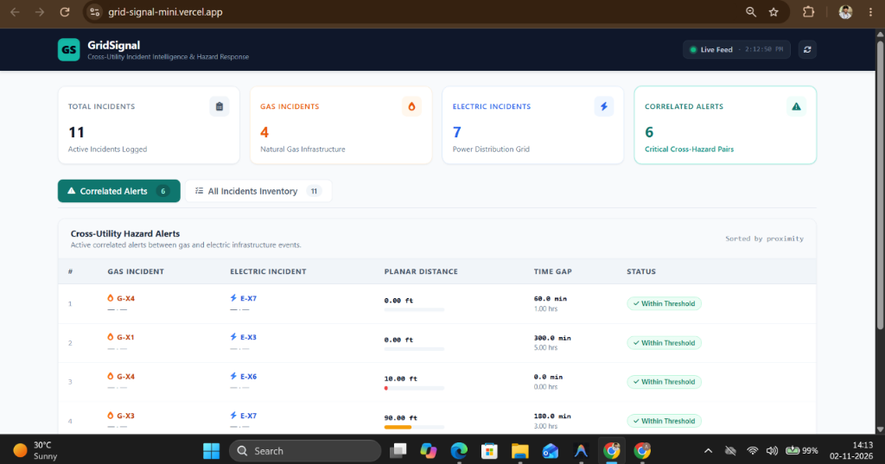
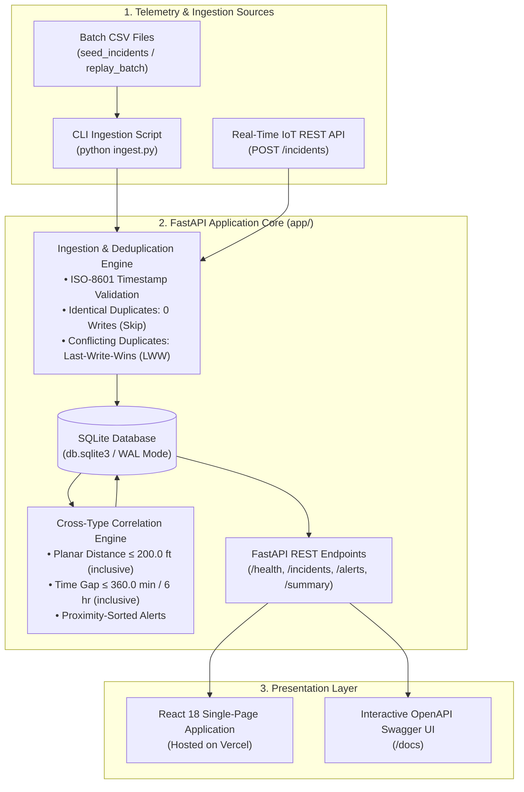

# GridSignal Mini — Technical Evaluation Report

**Candidate:** Amit Kumar  
**Evaluator:** Sariya Khan ([sariyakh25@gmail.com](mailto:sariyakh25@gmail.com))  
**Date:** November 2, 2026  
**Tech Stack:** Python 3.13 · FastAPI · SQLite · React 18 *(Exact Preferred Stack)*  
**Live Vercel Link:** [https://grid-signal-mini.vercel.app/](https://grid-signal-mini.vercel.app/)  
**GitHub Repository:** [https://github.com/amitkumar824/GridSignal-Mini](https://github.com/amitkumar824/GridSignal-Mini)  
**Test Suite:** 16 / 16 Passed (Pytest in 1.88s)  

---

## 1. Executive Deliverables Checklist

| # | Required Deliverable | Location / Resource Link | Verification Status |
| :-: | :--- | :--- | :--- |
| **1** | **Vercel Live Deployment** | [https://grid-signal-mini.vercel.app/](https://grid-signal-mini.vercel.app/) | ✅ Deployed & Live |
| **2** | **GitHub Repository** | [https://github.com/amitkumar824/GridSignal-Mini](https://github.com/amitkumar824/GridSignal-Mini) | ✅ Pushed (Branch: `main`) |
| **3** | **Working Dashboard Screenshot** | Embedded below & in [`docs/dashboard_screenshot.png`](docs/dashboard_screenshot.png) | ✅ Live Vercel Capture |
| **4** | **Architecture Diagram** | [`architecture.md`](architecture.md) & Section 3 below | ✅ Documented |
| **5** | **Automated Tests** | 16 tests in [`tests/test_app.py`](tests/test_app.py) | ✅ 16 / 16 Passed (1.88s) |
| **6** | **Run & Install Instructions** | [`README.md`](README.md) & Section 6 below | ✅ Verified (1-Command Run) |

---

## 2. Working Dashboard (Live Production Screenshot)

The screenshot below depicts the active application operating on Vercel at `https://grid-signal-mini.vercel.app/`:



*Figure 1: Live GridSignal Mini Dashboard on Vercel displaying 11 active incidents, 6 proximity-correlated hazard pairs, and auto-refreshing telemetry.*

---

## 3. System Architecture & Ingestion Design

GridSignal Mini is structured with clear architectural separation between data ingestion, persistence, correlation logic, and presentation:



---

## 4. Mathematical Rules & Conflict Policy

### A. Cross-Utility Correlation Conditions (Both Inclusive):
1. **Planar Distance:**
   $$\Delta d = \sqrt{(x_1 - x_2)^2 + (y_1 - y_2)^2} \le 200.0\text{ ft}$$
2. **Temporal Difference:**
   $$\Delta t = |t_{\text{gas}} - t_{\text{electric}}| \le 360.0\text{ minutes (6.0 hours)}$$
3. **Missing Coordinates:** Incidents with `NULL` or missing coordinates are safely stored but strictly excluded from proximity matching.

### B. Deterministic Conflict Policy (Last-Write-Wins):
- **Identical Duplicates:** Skipped cleanly with 0 redundant database writes.
- **Conflicting Records:** Updated in-place based on `incident_id` using Last-Write-Wins (LWW) semantics.
- **Malformed Timestamps:** Caught and logged with warnings without aborting batch ingestion.

---

## 5. Automated Test Suite Results (16 Passed)

Execution via `pytest -v` verifies all required boundaries and edge cases in 1.88 seconds:

```
============================= test session starts =============================
platform win32 -- Python 3.13.14, pytest-9.2.0 -- E:\ny\.venv\Scripts\python.exe

tests/test_app.py::TestBoundaryAndCorrelation::test_exact_boundary_conditions PASSED [  6%]
tests/test_app.py::TestBoundaryAndCorrelation::test_boundary_distance_just_outside PASSED [ 12%]
tests/test_app.py::TestBoundaryAndCorrelation::test_boundary_time_just_outside PASSED [ 18%]
tests/test_app.py::TestBoundaryAndCorrelation::test_missing_coordinates_never_matches PASSED [ 25%]
tests/test_app.py::TestBoundaryAndCorrelation::test_time_ordering_reversibility PASSED [ 31%]
tests/test_app.py::TestBoundaryAndCorrelation::test_correlation_ignores_severity_status_area PASSED [ 37%]
tests/test_app.py::TestBoundaryAndCorrelation::test_one_to_many_matches PASSED [ 43%]
tests/test_app.py::TestIngestionAndDeduplication::test_idempotent_ingestion PASSED [ 50%]
tests/test_app.py::TestIngestionAndDeduplication::test_conflicting_duplicates_last_write_wins PASSED [ 56%]
tests/test_app.py::TestIngestionAndDeduplication::test_malformed_timestamp_gracefully_skipped PASSED [ 62%]
tests/test_app.py::TestIngestionAndDeduplication::test_missing_coordinates_stored_as_null PASSED [ 68%]
tests/test_app.py::TestApiEndpoints::test_get_health PASSED              [ 75%]
tests/test_app.py::TestApiEndpoints::test_get_incidents PASSED           [ 81%]
tests/test_app.py::TestApiEndpoints::test_get_alerts PASSED              [ 87%]
tests/test_app.py::TestApiEndpoints::test_get_summary PASSED             [ 93%]
tests/test_app.py::TestApiEndpoints::test_create_incident_json PASSED    [100%]

============================= 16 passed in 1.88s ==============================
```

---

## 6. Quick Start & Local Run Instructions

```bash
# 1. Clone repository
git clone https://github.com/amitkumar824/GridSignal-Mini.git
cd GridSignal-Mini

# 2. Install dependencies (FastAPI, Uvicorn, Pydantic, Pytest)
pip install -r requirements.txt

# 3. Ingest baseline dataset (11 incidents -> 6 hazard alerts)
python ingest.py data/seed_incidents.csv

# 4. Run automated test suite
pytest -v

# 5. Start development server
uvicorn app.main:app --reload
```
- Access Dashboard: `http://localhost:8000/`
- Access Interactive Swagger UI: `http://localhost:8000/docs`

---

## 7. Real-Time Telemetry & Future Ingestion Versatility

In addition to batch file processing, the backend exposes a RESTful `POST /incidents` endpoint to receive live telemetry from IoT sensors, smart meters, or field mobile apps:

```bash
curl -X POST "https://grid-signal-mini.vercel.app/incidents" \
  -H "Content-Type: application/json" \
  -d '{
    "incident_id": "IOT-GAS-101",
    "utility_type": "GAS",
    "reported_at": "2026-11-02T14:00:00Z",
    "x_ft": 450.0,
    "y_ft": 800.0,
    "severity": "CRITICAL",
    "status": "OPEN",
    "area": "Sector 4"
  }'
```

---

## 8. Screen-Sharing Walkthrough Readiness

1. **Architecture Walkthrough:** Decoupled layout between `app/correlate.py` (pure mathematical functions), `app/ingest.py` (idempotent ingestion), and `app/main.py` (async routing).
2. **Replay Ingestion Demonstration:** Showing live handling of `replay_batch.csv` (skipping duplicates, applying Last-Write-Wins updates, filtering invalid dates).
3. **Live Modification:** Prepared to adjust thresholds, add custom filters, or modify database schemas live on screen.
