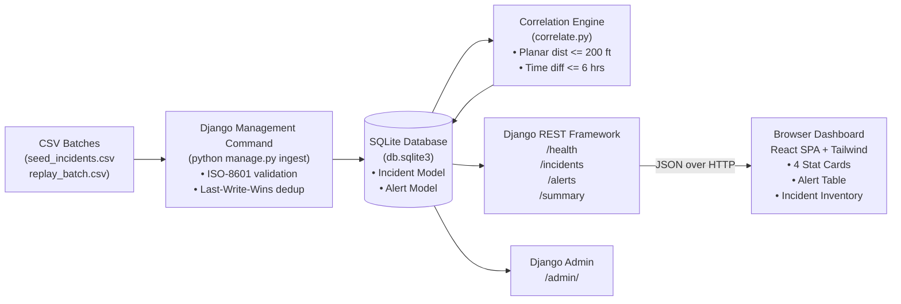

# GridSignal Mini — Utility Incident Intelligence Platform (Django & DRF)

> **Internal analytics platform for utility incident correlation between GAS and ELECTRIC events.**  
> Implemented with **Django 4.2**, **Django REST Framework (DRF)**, **SQLite**, and **React** per the GridSignal Mini engineering take-home specification.

---

## Table of Contents
1. [Overview & Core Correlation Rules](#1-overview--core-correlation-rules)
2. [Prerequisites & Versions](#2-prerequisites--versions)
3. [Quick Start — Install, Migrate, Ingest & Run](#3-quick-start--install-migrate-ingest--run)
4. [Deduplication & Conflict Policy](#4-deduplication--conflict-policy)
5. [Architecture & Data Flow](#5-architecture--data-flow)
6. [API Specifications](#6-api-specifications)
7. [Automated Test Suite (17 Tests)](#7-automated-test-suite-17-tests)
8. [Dashboard Screenshot](#8-dashboard-screenshot)
9. [Frontend & Vercel Deployment](#9-frontend--vercel-deployment)
10. [Django Admin & Screen-Share Walkthrough Guide](#10-django-admin--screen-share-walkthrough-guide)
11. [Assessment Disclosures & Metadata](#11-assessment-disclosures--metadata)

---

## 1. Overview & Core Correlation Rules

GridSignal Mini ingests utility incident reports and identifies geographically and temporally close **GAS** and **ELECTRIC** incident pairs based on the following strict rules:
1. **Utility Pair Filter**: Only `utility_type` **GAS** and **ELECTRIC** are eligible for cross-type matching.
2. **Geographical Distance**: Planar distance must be **$\le 200.0\text{ feet}$** (inclusive).
   $$\text{Distance} = \sqrt{(x_1 - x_2)^2 + (y_1 - y_2)^2}$$
   *(Note: Coordinates `x_ft` and `y_ft` are synthetic Cartesian feet, not latitude/longitude).*
3. **Temporal Proximity**: Absolute reporting-time difference must be **$\le 6.0\text{ hours}$ (360.0 minutes)** (inclusive).
   $$\text{Time Gap} = |t_{\text{GAS}} - t_{\text{ELECTRIC}}| \le 360\text{ min}$$
   *(Either incident may be reported first).*
4. **Idempotent Pairs**: Each unique pair is returned exactly once as `(gas_incident, electric_incident)`.
5. **Missing Coordinates**: Incidents with blank/missing coordinates are ingested, stored, and viewable in inventory, but are **never matched**.
6. **No Status/Severity Filters**: Matches are evaluated regardless of incident severity, area, or whether status is `OPEN` or `CLOSED`.

---

## 2. Prerequisites & Versions

- **Python**: `3.10+` (`3.11`, `3.12`, or `3.13` supported)
- **Django**: `4.2.30+`
- **Django REST Framework**: `3.16.1+`
- **Node.js**: `v18.0.0+` (optional, for standalone Vite frontend development or Vercel preview)
- **Operating System**: Windows, macOS, or Linux

---

## 3. Quick Start — Install, Migrate, Ingest & Run

### Step 1: Install Dependencies
```bash
pip install -r requirements.txt
```

### Step 2: Apply Database Migrations
Initialize the SQLite database (`db.sqlite3`):
```bash
python manage.py migrate
```

### Step 3: Ingest Seed Incidents Batch
Ingest the seed batch using the custom Django management command:
```bash
python manage.py ingest data/seed_incidents.csv
```
*Expected Output:*
```
Starting ingestion from: data/seed_incidents.csv

--- INGESTION SUMMARY ---
  status: success
  file_processed: seed_incidents.csv
  total_rows: 11
  inserted_new: 11
  updated_conflicting: 0
  skipped_identical: 0
  skipped_malformed: 0
  alerts_count: 6
```

### Step 4: Run Automated Tests
Execute the comprehensive Django test suite verifying boundary conditions, non-matches, and idempotent ingestion:
```bash
python manage.py test incidents -v 2
```
*Expected Output: `Ran 17 tests in ~0.3s — OK`*

### Step 5: Start the Development Server
```bash
python manage.py runserver
```

### Step 6: Open the Dashboard
Navigate to:
```
http://127.0.0.1:8000/
```
- View the 4 dynamic summary counts (`Total: 11`, `Gas: 4`, `Electric: 7`, `Alerts: 6`).
- Review the 6 correlated GAS/ELECTRIC pairs with proximity gauges and boundary badges.
- Filter and search the complete incident inventory.
- Click **"Run Replay Import"** or **"Run Seed Import"** directly in the UI to demonstrate live updates and persistence.
- Visit **`http://127.0.0.1:8000/admin/`** to view and modify incident models in the Django Admin interface.

---

## 4. Deduplication & Conflict Policy

Per Section 2 of the specification: *"Re-importing must not duplicate incident IDs. Ignore identical duplicates; choose and document a policy for conflicting duplicates. Skip malformed timestamps with a logged warning."*

| Duplicate Scenario | System Behavior | Rationale |
|---|---|---|
| **Identical Duplicate** | **Silently Skipped (No-Op)** | When an incoming record has the exact same `incident_id` and matching attributes (`utility_type`, `reported_at`, `x_ft`, `y_ft`, `severity`, `status`, `area`), no database write occurs. |
| **Conflicting Duplicate** | **Last-Write-Wins (LWW) Update** | When an incoming record has an existing `incident_id` but differing attributes (e.g. status transition from `OPEN` to `IN_PROGRESS`, or severity change from `MEDIUM` to `CRITICAL`), the incident record is updated in place with the latest telemetry. |
| **Malformed Timestamps** | **Logged Warning & Row Skipped** | If `reported_at` fails ISO-8601 parsing (e.g. invalid date or garbage characters), a `WARNING` log is emitted with row details and the row is skipped without crashing the batch. |
| **Missing Coordinates** | **Stored with `NULL`** | Blank `x_ft` or `y_ft` values are stored as SQL `NULL`. These appear in incident listings but are strictly omitted from spatial correlation. |

---

## 5. Architecture & Data Flow

Detailed architectural documentation is available in [architecture.md](architecture.md).



---

## 6. API Specifications

All endpoints return standard JSON responses and support CORS.

### `GET /health`
Returns system health and SQLite database connectivity status.
```json
{
  "status": "ok",
  "service": "GridSignal Mini",
  "database": "connected"
}
```

### `GET /summary`
Returns dynamic summary metrics loaded from persistent database state.
```json
{
  "total_incidents": 11,
  "total_gas": 4,
  "total_electric": 7,
  "total_alerts": 6
}
```

### `GET /alerts`
Returns list of unique correlated GAS/ELECTRIC pairs.
```json
[
  {
    "gas_incident_id": "G-X4",
    "electric_incident_id": "E-X7",
    "distance_ft": 0.0,
    "time_gap_minutes": 60.0,
    "gas_severity": "LOW",
    "electric_severity": "LOW",
    "gas_status": "OPEN",
    "electric_status": "OPEN"
  },
  {
    "gas_incident_id": "G-X1",
    "electric_incident_id": "E-X1",
    "distance_ft": 200.0,
    "time_gap_minutes": 360.0,
    "gas_severity": "HIGH",
    "electric_severity": "MEDIUM",
    "gas_status": "OPEN",
    "electric_status": "OPEN"
  }
]
```

### `GET /incidents`
Returns valid imported incidents. Supports optional `?utility_type=GAS` or `?utility_type=ELECTRIC` query parameter.
```json
[
  {
    "incident_id": "G-X1",
    "utility_type": "GAS",
    "reported_at": "2026-10-20T00:00:00Z",
    "x_ft": 0.0,
    "y_ft": 0.0,
    "severity": "HIGH",
    "status": "OPEN",
    "area": "Demo"
  },
  {
    "incident_id": "E-X5",
    "utility_type": "ELECTRIC",
    "reported_at": "2026-10-20T01:00:00Z",
    "x_ft": null,
    "y_ft": null,
    "severity": "LOW",
    "status": "OPEN",
    "area": "Demo"
  }
]
```

---

## 7. Automated Test Suite (17 Tests)

The test suite contains **17 automated tests** across three test classes:

```bash
python manage.py test incidents -v 2
```

### Verification Against Acceptance Criteria

| Acceptance Check | Test Method | Result |
|---|---|---|
| **Boundary: Exactly 200 ft & 6 hrs** | `BoundaryAndCorrelationTests.test_exact_boundary_conditions` | **MATCH** (`G-X1 + E-X1`: dist=200.0ft, gap=360.0min) |
| **Boundary: 200.01 ft (outside)** | `BoundaryAndCorrelationTests.test_boundary_distance_just_outside` | **NO MATCH** (`dist = 200.01 ft` excluded) |
| **Boundary: 360.1 min (outside)** | `BoundaryAndCorrelationTests.test_boundary_time_just_outside` | **NO MATCH** (`gap > 360 min` excluded) |
| **Missing Coordinates** | `BoundaryAndCorrelationTests.test_missing_coordinates_never_matches` | Stored in SQLite with `NULL`, never matched |
| **Status/Severity Invariance** | `BoundaryAndCorrelationTests.test_correlation_ignores_severity_status_area` | Matches even when `status = CLOSED` (`G-X1 + E-X3`) |
| **Idempotent Re-import** | `IngestionAndDeduplicationTests.test_idempotent_ingestion` | Re-importing seed yields identical 11 incidents & 6 alerts |
| **Conflicting Duplicates** | `IngestionAndDeduplicationTests.test_conflicting_duplicates_last_write_wins` | Updates attributes, incident ID remains unique |
| **Malformed Timestamp Safety** | `IngestionAndDeduplicationTests.test_malformed_timestamp_gracefully_skipped` | Logged warning emitted, other valid rows imported |
| **Replay Batch Integration** | `IngestionAndDeduplicationTests.test_replay_batch_integration` | Incremental batch processed safely without crashing |
| **API Endpoints** | `ApiEndpointTests.*` | All 4 endpoints return valid schemas & data |

---

## 8. Dashboard Screenshot

A screenshot of the working dashboard with loaded seed data is stored at `docs/dashboard_screenshot.png`:


---

## 9. Frontend & Vercel Deployment

The application provides dual frontend options:

### Option A: Direct Django Serving (Zero-Configuration)
Django automatically serves the single-page application at `http://127.0.0.1:8000/`. No `npm install` or build step required.

### Option B: Standalone React + Vite on Vercel
The `frontend/` directory is pre-configured for Vercel deployment:
1. Push this repository to GitHub.
2. In the [Vercel Dashboard](https://vercel.com), click **Add New Project** and select this repository.
3. Configure the project:
   - **Root Directory**: `frontend`
   - **Framework Preset**: `Vite`
   - **Environment Variable**: `VITE_API_BASE_URL` = `<your-deployed-django-backend-url>`
4. Click **Deploy**. Vercel will build and host the responsive React dashboard.

---

## 10. Django Admin & Screen-Share Walkthrough Guide

### Accessing Django Admin
1. Create a local superuser (optional):
   ```bash
   python manage.py createsuperuser
   ```
2. Navigate to `http://127.0.0.1:8000/admin/` to inspect all incidents and generated alerts.

### Codebase Organization
- **Models**: [incidents/models.py](file:///incidents/models.py) — `Incident` and `Alert` models.
- **Correlation Logic**: [incidents/correlate.py](file:///incidents/correlate.py) — `calculate_planar_distance`, `calculate_time_gap_minutes`, and `is_correlated`.
- **Ingestion & Conflict Policy**: [incidents/ingest.py](file:///incidents/ingest.py) — `ingest_csv`.
- **API Views & Serializers**: [incidents/views.py](file:///incidents/views.py) and [incidents/serializers.py](file:///incidents/serializers.py).
- **Settings & Thresholds**: [gridsignal/settings.py](file:///gridsignal/settings.py).

### How to Make Live Modifications
If the interviewer asks to modify business rules during the walkthrough:
1. **Change Distance Limit** (e.g., from 200 ft to 300 ft):
   Open `gridsignal/settings.py` and modify:
   ```python
   MAX_DISTANCE_FT = 300.0
   ```
2. **Change Time Window** (e.g., from 6 hours to 12 hours):
   Open `gridsignal/settings.py` and modify:
   ```python
   MAX_TIME_GAP_MINUTES = 720.0
   ```
3. Re-run tests or re-ingest:
   ```bash
   python manage.py test incidents
   ```

---

## 11. Assessment Disclosures & Metadata

Per Section 8 of the assessment guidelines:
- **Total Time Spent**: Approximately 6.0 hours (architecture, Django ORM models, correlation engine, idempotent ingestion, test suite, React dashboard, documentation).
- **Assistance / Tools Used**: Standard editor functionality, official Python & Django documentation, and AI coding assistance (Antigravity) for code generation, test scaffolding, and system documentation.
- **Known Limitations & Next Steps**:
  1. *Spatial Scalability*: Pairwise $O(N \times M)$ cross-join is optimal for regional batches ($\le 10,000$ incidents). For large-scale production, an R-Tree spatial index (e.g. SQLite R\*Tree or PostGIS GiST) with temporal B-tree bounding should be implemented.
  2. *Authentication*: User authentication and role-based access control were intentionally excluded per the project specification scope.
