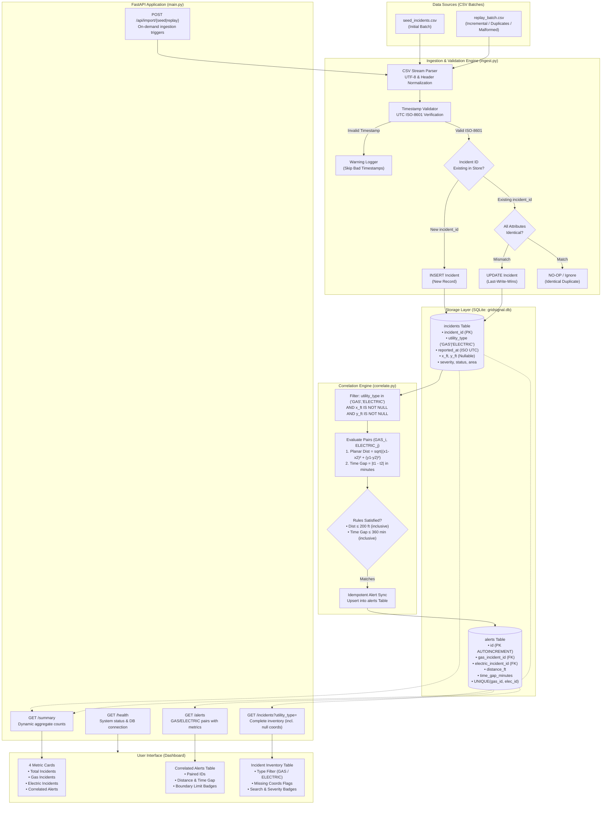

# GridSignal Mini — System Architecture & Design Documentation

## 1. System Architecture Diagram

---

## 2. Architecture & Data Flow Explanation

1. **Ingestion & Validation**: Incoming CSV data files (`seed_incidents.csv`, `replay_batch.csv`) are ingested sequentially row-by-row. Each row undergoes strict ISO-8601 timestamp validation; malformed timestamps are rejected with a structured warning log without halting batch execution, while incidents with blank coordinates are ingested with explicit `NULL` coordinates.
2. **Persistence Layer**: Data is stored locally in an ACID-compliant SQLite relational database (`gridsignal.db`). The `incidents` table enforces unique incident IDs as the primary key and maintains indexes on `utility_type` and coordinates `(x_ft, y_ft)` for sub-millisecond query retrieval.
3. **Deduplication & Conflict Handling**: When an imported record matches an existing `incident_id`, the system compares all attributes. If identical, the record is skipped with zero mutation; if conflicting, the system applies a **Last-Write-Wins (LWW)** policy, updating severity, status, timestamps, and coordinates to reflect the latest operational telemetry.
4. **Correlation Engine**: The matching pipeline extracts all `GAS` and `ELECTRIC` incidents that possess non-null planar coordinates. It executes a cross-type pairing that evaluates the synthetic Euclidean planar distance (`sqrt((x1-x2)² + (y1-y2)²)`) and absolute reporting-time difference (`|t_gas - t_electric|`).
5. **Correlation Rules & Boundary Inclusivity**: A potential match is validated if and only if planar distance is $\le 200.0\text{ ft}$ and time difference is $\le 360.0\text{ min}$ (6 hours). Both boundary limits are strictly inclusive (meaning exactly $200.0\text{ ft}$ and $360.0\text{ min}$ match, while $200.01\text{ ft}$ or $360.01\text{ min}$ are excluded).
6. **Alert Idempotency**: Pairs are normalized into unique `(gas_incident_id, electric_incident_id)` tuples and persisted into the `alerts` table with a composite unique constraint, ensuring that successive ingestion passes produce deterministic alert sets without duplicates.
7. **API Layer**: FastAPI exposes four REST endpoints: `GET /health` (readiness probe), `GET /incidents` (supporting `?utility_type=GAS|ELECTRIC` filtering), `GET /alerts` (returning paired incident IDs, planar distance in feet, and time gap in minutes), and `GET /summary` (delivering live aggregate counts).
8. **User Interface**: The browser dashboard automatically polls and renders live data from the API into 4 key metric cards, an interactive alert table with proximity gauges and exact-boundary badges, and a searchable incident inventory.

---

## 3. Design Tradeoffs

### Tradeoff 1: In-Memory Cross-Join vs. Spatial Indexing (R-Tree / PostGIS)
- **Current Approach**: The correlation engine filters eligible GAS and ELECTRIC records and performs an $O(N \times M)$ pairwise distance and temporal comparison.
- **Rationale**: For take-home, regional, or departmental workloads ($\le 10,000$ active incidents), an $O(N \times M)$ comparison in Python executes in under 15 milliseconds. It avoids bulky external C-dependencies (such as GDAL, GEOS, or SpatiaLite) and allows the evaluation logic to be completely transparent and easily modified during screen sharing.
- **Scale-Up Path**: In an enterprise deployment handling millions of continuous IoT pings, this should be upgraded to an R-Tree spatial index (e.g., SQLite R*Tree module or PostgreSQL with PostGIS GiST indexes) paired with a temporal B-tree index, bounding search queries to a bounding box of $[x - 200, x + 200]$ and $[t - 6\text{h}, t + 6\text{h}]$ to achieve $O(\log N)$ query complexity.

### Tradeoff 2: Full Alert Recalculation vs. Incremental Event-Driven Pairing
- **Current Approach**: After every CSV ingestion batch, the correlation engine recalculates the alert set from persistent state.
- **Rationale**: Guaranteed idempotency and zero state-drift. If an existing incident's coordinates or timestamp are updated via a conflicting duplicate, full recalculation automatically cleans up invalid alerts and establishes new matches without requiring complex change-data-capture logic.
- **Scale-Up Path**: An event-driven architecture using Kafka or Redis streams where each newly ingested incident only checks candidate counterparts within the spatio-temporal boundary, emitting incremental alert events.

### Tradeoff 3: Relational SQLite vs. Distributed Database
- **Current Approach**: Embedded SQLite database with foreign keys and WAL mode.
- **Rationale**: Zero external setup requirements, instant automated test execution via ephemeral databases, deterministic file-level persistence, and identical SQL semantics to PostgreSQL.
