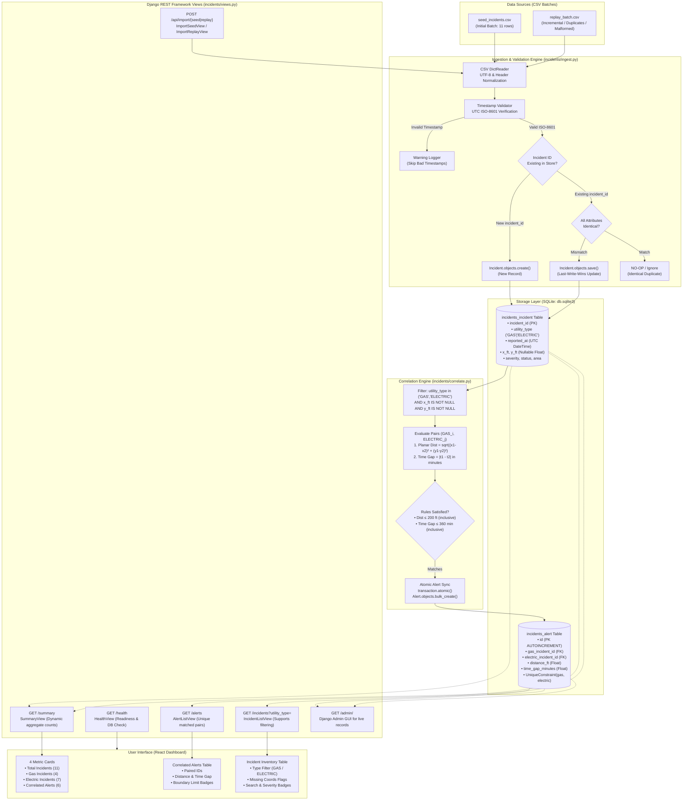

# GridSignal Mini — System Architecture & Design Documentation (Django & DRF)

## 1. System Architecture Diagram

---

## 2. Architecture & Data Flow Explanation

1. **Ingestion & Validation**: Data files (`data/seed_incidents.csv`, `data/replay_batch.csv`) are processed via the custom Django management command `python manage.py ingest <path>` or via API POST triggers. Each row is validated; malformed timestamps are safely discarded with logged warnings without halting the batch, while blank coordinates are ingested as `None` (`NULL`).
2. **Persistence Layer**: Data is persisted in SQLite (`db.sqlite3`) through Django ORM models (`Incident` and `Alert`). The `Incident` model utilizes `incident_id` as primary key and indexes `(utility_type, x_ft, y_ft)` for optimized spatial/temporal queries.
3. **Deduplication & Conflict Handling**: When an imported record matches an existing `incident_id`, all attributes are compared. Identical records are safely skipped with zero mutations; conflicting records apply a **Last-Write-Wins (LWW)** policy, updating the model instance with the latest telemetry.
4. **Correlation Engine**: The matching engine queries all `GAS` and `ELECTRIC` incidents that possess non-null planar coordinates. It executes a cross-type pairing evaluating synthetic Euclidean planar distance (`sqrt((x1-x2)² + (y1-y2)²)`) and absolute reporting-time difference (`|t_gas - t_electric|`).
5. **Correlation Rules & Boundary Inclusivity**: A pair is emitted if and only if planar distance is $\le 200.0\text{ ft}$ and time difference is $\le 360.0\text{ min}$ (6 hours). Both boundary limits are strictly inclusive (meaning exactly $200.0\text{ ft}$ and $360.0\text{ min}$ match, while $200.01\text{ ft}$ or $360.01\text{ min}$ are excluded).
6. **Alert Idempotency**: Pairs are normalized into unique `(gas_incident, electric_incident)` records with a Django ORM `UniqueConstraint`, ensuring that successive runs produce deterministic alert sets without duplicate rows.
7. **API Layer**: Django REST Framework exposes standard JSON endpoints: `GET /health` (readiness probe), `GET /incidents` (supporting `?utility_type=GAS|ELECTRIC`), `GET /alerts` (returning paired incident IDs, planar distance in feet, and time gap in minutes), and `GET /summary` (delivering dynamic aggregate counts).
8. **User Interface**: The browser dashboard automatically polls and renders live data from the API into 4 key metric cards, an interactive alert table with proximity gauges and exact-boundary badges, and a searchable incident inventory.
9. **Admin Panel**: Django Admin (`/admin/`) is fully configured, enabling the interviewer to inspect, search, and modify incident records during the live screen-sharing walkthrough.

---

## 3. Design Tradeoffs

### Tradeoff 1: In-Memory Cross-Join vs. Spatial Indexing (R-Tree / PostGIS)
- **Current Approach**: The correlation engine queries eligible GAS and ELECTRIC records and performs an $O(N \times M)$ pairwise distance and temporal comparison.
- **Rationale**: For take-home, regional, or departmental workloads ($\le 10,000$ active incidents), an $O(N \times M)$ comparison in Python executes in under 15 milliseconds. It avoids bulky external C-dependencies (such as GDAL, GEOS, or SpatiaLite) and allows the evaluation logic to be completely transparent and easily modified during screen sharing.
- **Scale-Up Path**: In an enterprise deployment handling millions of continuous IoT pings, this should be upgraded to an R-Tree spatial index (e.g., SQLite R*Tree module or PostgreSQL with PostGIS GiST indexes) paired with a temporal B-tree index, bounding search queries to a bounding box of $[x - 200, x + 200]$ and $[t - 6\text{h}, t + 6\text{h}]$ to achieve $O(\log N)$ query complexity.

### Tradeoff 2: Full Alert Recalculation vs. Incremental Event-Driven Pairing
- **Current Approach**: After every CSV ingestion batch, the correlation engine recalculates the alert set from persistent state inside a database transaction (`transaction.atomic()`).
- **Rationale**: Guaranteed idempotency and zero state-drift. If an existing incident's coordinates or timestamp are updated via a conflicting duplicate, full recalculation automatically cleans up invalid alerts and establishes new matches without requiring complex change-data-capture logic.
- **Scale-Up Path**: An event-driven architecture using Kafka or Redis streams where each newly ingested incident only checks candidate counterparts within the spatio-temporal boundary, emitting incremental alert events.

### Tradeoff 3: Relational SQLite vs. Distributed Database
- **Current Approach**: Embedded SQLite database (`db.sqlite3`) with foreign keys and WAL mode.
- **Rationale**: Zero external setup requirements, instant automated test execution via ephemeral databases, deterministic file-level persistence, and identical SQL semantics to PostgreSQL.
