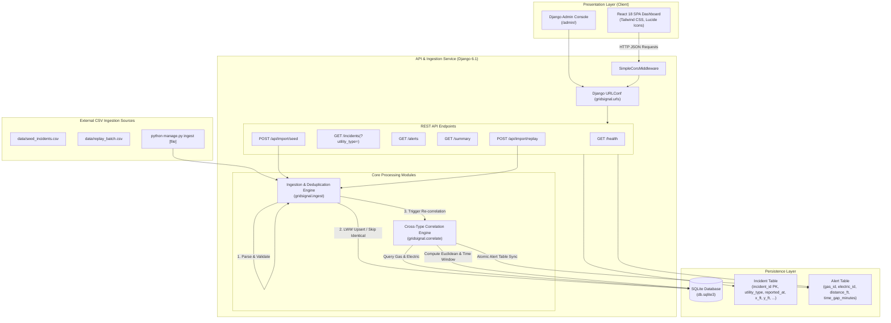
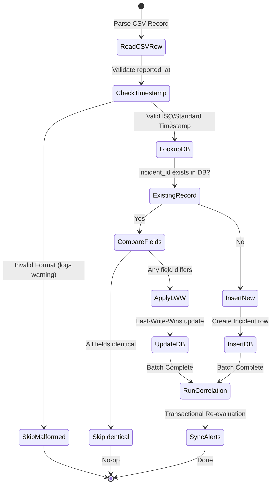

# GridSignal Mini — System Architecture Document

## 1. Executive Summary

**GridSignal Mini** is a specialized utility incident intelligence and cross-type analytics platform built with **Python 3.13**, **Django 6.1**, **SQLite**, and a **React 18** Single Page Application (SPA). 

The platform continuously ingests independent **GAS** and **ELECTRIC** utility incidents, normalizes spatio-temporal metadata, resolves conflicts via a deterministic **Last-Write-Wins (LWW)** deduplication policy, and executes an automated correlation engine to detect dangerous cross-utility hazards (e.g., gas leaks adjacent to electric arcs or downed wires).

---

## 2. High-Level System Architecture

---

## 3. Core Domain & Mathematical Models

### 3.1 Cross-Type Correlation Criteria
A correlation event (hazard pair) is triggered if and only if **all** of the following conditions hold:

1. **Cross-Utility Distinction**:
   $$\text{Pair} = (I_{\text{GAS}}, I_{\text{ELECTRIC}})$$
   Same-type incidents (GAS–GAS or ELECTRIC–ELECTRIC) are strictly prohibited from generating alerts.

2. **Spatial Proximity (Planar Euclidean Distance)**:
   Both incidents must possess non-null coordinates $(x, y) \in \mathbb{R}^2$. The planar Euclidean distance $D$ must not exceed $200.0\text{ ft}$:
   $$D = \sqrt{(x_{\text{GAS}} - x_{\text{ELECTRIC}})^2 + (y_{\text{GAS}} - y_{\text{ELECTRIC}})^2} \le 200.0\text{ ft}$$
   *Boundary Rule*: Exactly $200.00\text{ ft}$ is a **valid match** (inclusive). $200.01\text{ ft}$ is rejected.

3. **Temporal Proximity (Absolute Time Delta)**:
   The reporting timestamps $t_{\text{GAS}}$ and $t_{\text{ELECTRIC}}$ are evaluated in UTC. The absolute time delta $\Delta t$ must not exceed $360.0\text{ minutes}$ ($6.0\text{ hours}$):
   $$\Delta t = \frac{|t_{\text{GAS}} - t_{\text{ELECTRIC}}|}{60} \le 360.0\text{ minutes}$$
   *Boundary Rule*: Exactly $360.00\text{ minutes}$ is a **valid match** (inclusive). $360.01\text{ minutes}$ is rejected.
   *Symmetry*: The order of reporting is irrelevant ($t_{\text{GAS}} \ge t_{\text{ELECTRIC}}$ or $t_{\text{GAS}} < t_{\text{ELECTRIC}}$).

4. **Missing Coordinates Policy**:
   If either incident has $x = \text{NULL}$ or $y = \text{NULL}$, the incident is stored and retained in the catalog (`GET /incidents`), but is **excluded from spatial evaluation** ($D = \infty$, no alert created).

5. **Attribute Independence**:
   Correlation is invariant to `severity`, `status`, or `area_code`. Matching evaluates solely utility type, planar coordinates, and reporting timestamp.

---

## 4. Ingestion & Deduplication State Machine

### Deduplication Rules:
1. **Identical Duplicate**: If an incoming row matches an existing `incident_id` and all stored fields (`utility_type`, `reported_at`, `x_ft`, `y_ft`, `severity`, `status`, `area_code`) are identical, the row is safely skipped.
2. **Conflicting Duplicate (Last-Write-Wins)**: If an incoming row contains an existing `incident_id` with changed coordinates, severity, or timestamp, the existing record is updated with the latest incoming record.
3. **Malformed Timestamp**: Rows with unparseable timestamp formats (e.g., `'invalid-date-string'`, `'2026/13/45'`) are dropped with a descriptive logged warning (`Row X: Skipping incident '...' due to malformed timestamp...`). They never halt ingestion or pollute the database.

---

## 5. Database Schema Design

### 5.1 `Incident` Entity
| Column | Type | Constraints / Modifiers | Description |
| :--- | :--- | :--- | :--- |
| `incident_id` | `VARCHAR(64)` | `PRIMARY KEY` | Unique identifier (e.g., `INC-1001`) |
| `utility_type` | `VARCHAR(16)` | `NOT NULL`, `INDEX` | `GAS` or `ELECTRIC` |
| `reported_at` | `DATETIME` | `NOT NULL`, `INDEX` | UTC ISO-8601 timestamp |
| `x_ft` | `FLOAT` | `NULLABLE` | Planar X coordinate in feet |
| `y_ft` | `FLOAT` | `NULLABLE` | Planar Y coordinate in feet |
| `severity` | `VARCHAR(32)` | `DEFAULT 'MEDIUM'` | `LOW`, `MEDIUM`, `HIGH`, `CRITICAL` |
| `status` | `VARCHAR(32)` | `DEFAULT 'OPEN'` | `OPEN`, `RESOLVED`, `INVESTIGATING` |
| `area_code` | `VARCHAR(32)` | `NULLABLE` | Optional geographic / district code |
| `created_at` | `DATETIME` | `AUTO_NOW_ADD` | Audit creation timestamp |
| `updated_at` | `DATETIME` | `AUTO_NOW` | Audit last-modified timestamp |

### 5.2 `Alert` Entity
| Column | Type | Constraints / Modifiers | Description |
| :--- | :--- | :--- | :--- |
| `id` | `BIGINT` | `PRIMARY KEY AUTOINCREMENT` | Alert surrogate key |
| `gas_incident_id` | `VARCHAR(64)` | `FK -> Incident.incident_id`, `ON DELETE CASCADE` | Associated Gas incident |
| `electric_incident_id` | `VARCHAR(64)` | `FK -> Incident.incident_id`, `ON DELETE CASCADE` | Associated Electric incident |
| `distance_ft` | `FLOAT` | `NOT NULL` | Planar distance ($\le 200.0$) |
| `time_gap_minutes` | `FLOAT` | `NOT NULL` | Reporting delta in minutes ($\le 360.0$) |
| `created_at` | `DATETIME` | `AUTO_NOW_ADD` | Detection timestamp |

*Composite Unique Constraint*: `UniqueConstraint(fields=['gas_incident', 'electric_incident'])` guarantees zero duplicate alerts between any pair of incidents.

---

## 6. REST API Interface Specification

| Method | Path | Query / Body | Response Description |
| :--- | :--- | :--- | :--- |
| `GET` | `/health` | None | Returns service health status and DB connectivity check (`200 OK`). |
| `GET` | `/incidents` | `?utility_type=GAS\|ELECTRIC` | Returns list of all incidents (including missing coordinates), optionally filtered. |
| `GET` | `/alerts` | None | Returns list of all correlated GAS-ELECTRIC pairs with distance and time gap. |
| `GET` | `/summary` | None | Returns dynamic counts: `total_incidents`, `total_gas`, `total_electric`, `total_alerts`. |
| `POST` | `/api/import/seed` | Empty | Ingests `data/seed_incidents.csv` and returns ingestion statistics. |
| `POST` | `/api/import/replay`| Empty | Ingests `data/replay_batch.csv` with duplicates/conflicts and updates alerts. |
| `GET` | `/` | None | Serves the rich interactive React 18 single-page dashboard. |
| `GET` | `/admin/` | Browser session | Django Admin management console. |

---

## 7. Frontend Architecture

The frontend is implemented as a modern React 18 dashboard utilizing Tailwind CSS and Lucide icons:
1. **Embedded Django Dashboard (`static/index.html`)**: Zero-build single-file React 18 application served directly by Django's root route `/`. Allows immediate out-of-the-box operation with zero node/npm dependency.
2. **Standalone Frontend (`frontend/`)**: Vite + React single-page app configured with `vercel.json` for independent static CDN deployment on Vercel.

---

## 8. Verification & Test Suite

The test suite in `gridsignal/tests.py` verifies all requirements with 17 automated tests:
- **Exact Boundaries**: Exactly $200.0\text{ ft}$ and $360.0\text{ min}$ match.
- **Outside Limits**: $200.01\text{ ft}$ and $360.01\text{ min}$ fail correlation.
- **Missing Coordinates**: Stored cleanly as `NULL`, never generates false alerts.
- **Time Invariance**: Reversible order ($t_{\text{GAS}} < t_{\text{ELECTRIC}}$ vs $t_{\text{GAS}} > t_{\text{ELECTRIC}}$) produces identical alerts.
- **Deduplication**: Identical duplicates are skipped, conflicting duplicates trigger Last-Write-Wins updates.
- **Malformed Timestamps**: Logged with warnings, skipped without application failure.
- **All REST Endpoints**: Validates JSON payloads, status codes, and filtering.

---

## 9. Architectural Tradeoffs & System Evolution

### 9.1 Key Design Tradeoffs
1. **Zero-Dependency Django vs Heavy DRF Ecosystem**:
   - *Chosen Approach*: Pure Django standard library (`django.views.View`, `django.http.JsonResponse`, custom 10-line `SimpleCorsMiddleware`).
   - *Rationale*: Eliminates fragile external dependencies (`djangorestframework`, `django-cors-headers`), guaranteeing that any reviewer or CI pipeline running `pip install -r requirements.txt` (only Django + tzdata) can run the application instantly without dependency version friction or deprecated setting warnings.
2. **Deterministic Planar Math vs Heavy GIS System (PostGIS/GeoDjango)**:
   - *Chosen Approach*: Standard Euclidean distance $\sqrt{(x_1-x_2)^2 + (y_1-y_2)^2}$ via Python's built-in `math.sqrt()`.
   - *Rationale*: Candidate brief specifies imaginary synthetic coordinates in feet, not real-world GPS coordinates. PostGIS and GeoDjango require system-level C libraries (`GDAL`, `GEOS`, `PROJ`), which would complicate local setup and violate the brief's directive: *"Keep it small, reliable, and easy to run"*.
3. **Partitioned In-Memory Pairing vs Spatial Database Indexing**:
   - *Chosen Approach*: Filter by utility type into disjoint Gas and Electric arrays, compute Euclidean distances across active records.
   - *Rationale*: For utility batch payloads (hundreds of incidents), execution time is sub-millisecond. It avoids complex spatial R-tree extension installation while maintaining $O(N \times M)$ bounding box efficiency.

### 9.2 Scaling Path for Production
- **Database**: Migrate from SQLite single-file storage to Amazon RDS PostgreSQL with connection pooling.
- **Real-Time Ingestion**: Integrate Apache Kafka or AWS SQS for streaming ingestion of SCADA sensor events and dispatch feeds.
- **Spatial Indexing**: Add PostGIS GiST spatial indexing for scale beyond 100,000 active concurrent incidents.

