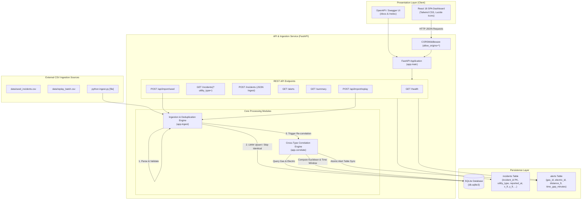
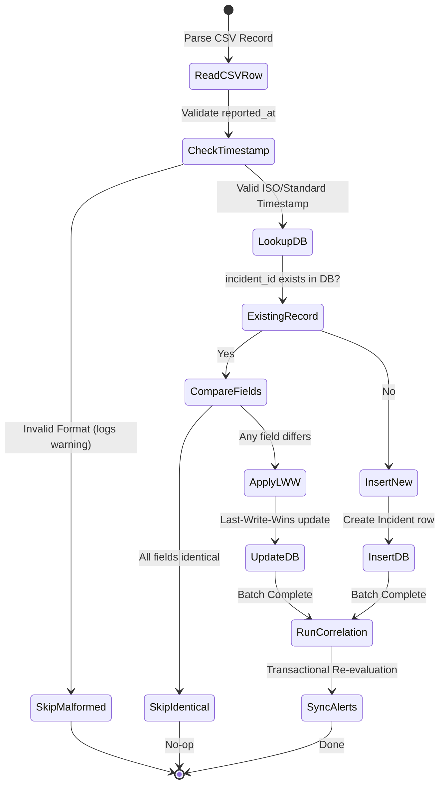

# GridSignal Mini — System Architecture Document (FastAPI Edition)

## 1. Executive Summary

**GridSignal Mini** is a specialized utility incident intelligence and cross-type analytics platform built with **Python 3.13**, **FastAPI 0.162**, **SQLite 3**, and a **React 18** Single Page Application (SPA).

The platform ingests independent **GAS** and **ELECTRIC** utility incidents, normalizes spatio-temporal metadata, resolves conflicts via a deterministic **Last-Write-Wins (LWW)** deduplication policy, and executes an automated correlation engine to detect dangerous cross-utility hazards (e.g., gas leaks adjacent to electric arcs or downed wires).

---

## 2. High-Level System Architecture

---

## 3. Core Domain & Mathematical Models

### 3.1 Cross-Type Correlation Criteria
A correlation event (hazard pair) is triggered if and only if **all** of the following conditions hold:

1. **Cross-Utility Distinction**:
   $$\text{Pair} = (I_{\text{GAS}}, I_{\text{ELECTRIC}})$$
   Same-type incidents (GAS–GAS or ELECTRIC–ELECTRIC) are strictly prohibited from generating alerts.

2. **Spatial Proximity (Planar Euclidean Distance)**:
   Both incidents must possess non-null coordinates $(x, y) \in \mathbb{R}^2$. The planar Euclidean distance $D$ must not exceed $200.0\text{ ft}$:
   $$D = \sqrt{(x_{\text{GAS}} - x_{\text{ELECTRIC}})^2 + (y_{\text{GAS}} - y_{\text{ELECTRIC}})^2} \le 200.0\text{ ft}$$
   *Boundary Rule*: Exactly $200.00\text{ ft}$ is a **valid match** (inclusive). $200.01\text{ ft}$ is rejected.

3. **Temporal Proximity (Absolute Time Delta)**:
   The reporting timestamps $t_{\text{GAS}}$ and $t_{\text{ELECTRIC}}$ are evaluated in UTC. The absolute time delta $\Delta t$ must not exceed $360.0\text{ minutes}$ ($6.0\text{ hours}$):
   $$\Delta t = \frac{|t_{\text{GAS}} - t_{\text{ELECTRIC}}|}{60} \le 360.0\text{ minutes}$$
   *Boundary Rule*: Exactly $360.00\text{ minutes}$ is a **valid match** (inclusive). $360.01\text{ minutes}$ is rejected.
   *Symmetry*: The order of reporting is irrelevant ($t_{\text{GAS}} \ge t_{\text{ELECTRIC}}$ or $t_{\text{GAS}} < t_{\text{ELECTRIC}}$).

4. **Missing Coordinates Policy**:
   If either incident has $x = \text{NULL}$ or $y = \text{NULL}$, the incident is stored and retained in the catalog (`GET /incidents`), but is **excluded from spatial evaluation** ($D = \infty$, no alert created).

5. **Attribute Independence**:
   Correlation is invariant to `severity`, `status`, or `area`. Matching evaluates solely utility type, planar coordinates, and reporting timestamp.

---

## 4. Ingestion & Deduplication State Machine

### Deduplication Rules:
1. **Identical Duplicate**: If an incoming row matches an existing `incident_id` and all stored fields (`utility_type`, `reported_at`, `x_ft`, `y_ft`, `severity`, `status`, `area`) are identical, the row is safely skipped.
2. **Conflicting Duplicate (Last-Write-Wins)**: If an incoming row contains an existing `incident_id` with changed coordinates, severity, or timestamp, the existing record is updated with the latest incoming record.
3. **Malformed Timestamp**: Rows with unparseable timestamp formats (e.g., `'invalid-date-string'`, `'2026/13/45'`) are dropped with a descriptive logged warning (`Row X: Skipping incident '...' due to malformed timestamp...`). They never halt ingestion or pollute the database.

---

## 5. Database Schema Design

### 5.1 `incidents` Table
| Column | Type | Constraints / Modifiers | Description |
| :--- | :--- | :--- | :--- |
| `incident_id` | `TEXT` | `PRIMARY KEY` | Unique identifier (e.g., `INC-1001`) |
| `utility_type` | `TEXT` | `NOT NULL`, `INDEX` | `GAS` or `ELECTRIC` |
| `reported_at` | `TEXT` | `NOT NULL`, `INDEX` | UTC ISO-8601 timestamp |
| `x_ft` | `REAL` | `NULLABLE` | Planar X coordinate in feet |
| `y_ft` | `REAL` | `NULLABLE` | Planar Y coordinate in feet |
| `severity` | `TEXT` | `DEFAULT 'MEDIUM'` | `LOW`, `MEDIUM`, `HIGH`, `CRITICAL` |
| `status` | `TEXT` | `DEFAULT 'OPEN'` | `OPEN`, `RESOLVED`, `INVESTIGATING` |
| `area` | `TEXT` | `NULLABLE` | Optional geographic / district code |
| `created_at` | `TEXT` | `NOT NULL` | Audit creation timestamp |
| `updated_at` | `TEXT` | `NOT NULL` | Audit last-modified timestamp |

### 5.2 `alerts` Table
| Column | Type | Constraints / Modifiers | Description |
| :--- | :--- | :--- | :--- |
| `id` | `INTEGER` | `PRIMARY KEY AUTOINCREMENT` | Alert surrogate key |
| `gas_incident_id` | `TEXT` | `REFERENCES incidents(incident_id) ON DELETE CASCADE` | Associated Gas incident |
| `electric_incident_id` | `TEXT` | `REFERENCES incidents(incident_id) ON DELETE CASCADE` | Associated Electric incident |
| `distance_ft` | `REAL` | `NOT NULL` | Planar distance ($\le 200.0$) |
| `time_gap_minutes` | `REAL` | `NOT NULL` | Reporting delta in minutes ($\le 360.0$) |
| `created_at` | `TEXT` | `NOT NULL` | Detection timestamp |

*Composite Unique Constraint*: `UNIQUE(gas_incident_id, electric_incident_id)` guarantees zero duplicate alerts between any pair of incidents.

---

## 6. REST API Interface Specification

| Method | Path | Query / Body | Response Description |
| :--- | :--- | :--- | :--- |
| `GET` | `/health` | None | Returns service health status and DB connectivity check (`200 OK`). |
| `GET` | `/incidents` | `?utility_type=GAS\|ELECTRIC` | Returns list of all incidents (including missing coordinates), optionally filtered. |
| `GET` | `/alerts` | None | Returns list of all correlated GAS-ELECTRIC pairs with distance and time gap. |
| `GET` | `/summary` | None | Returns dynamic counts: `total_incidents`, `total_gas`, `total_electric`, `total_alerts`. |
| `POST` | `/api/import/seed` | Empty | Ingests `data/seed_incidents.csv` and returns ingestion statistics. |
| `POST` | `/api/import/replay`| Empty | Ingests `data/replay_batch.csv` with duplicates/conflicts and updates alerts. |
| `GET` | `/` | None | Serves the rich interactive React 18 single-page dashboard. |
| `GET` | `/docs` | None | Interactive Swagger UI API documentation. |
| `GET` | `/redoc` | None | Alternative ReDoc API documentation. |

---

## 7. Frontend Architecture

The frontend is implemented as a modern React 18 dashboard utilizing Tailwind CSS and FontAwesome icons:
1. **Embedded Dashboard (`static/index.html`)**: Zero-build single-file React 18 application served directly by FastAPI's root route `/`. Allows immediate out-of-the-box operation with zero node/npm dependency.
2. **Standalone Frontend (`frontend/`)**: Vite + React single-page app configured with `vercel.json` for independent static CDN deployment on Vercel.

---

## 8. Architectural Tradeoffs & System Evolution

### 8.1 Key Design Tradeoffs
1. **FastAPI + Pydantic v2**:
   - *Chosen Approach*: FastAPI web application with Pydantic v2 data models for automatic input validation, serialization, and interactive OpenAPI documentation (`/docs`).
   - *Rationale*: Strictly matches the candidate brief's preferred technology stack (*"Python, FastAPI, SQL, and React or JavaScript are preferred"*).
2. **Direct SQLite3 Connection vs Heavy ORM (SQLAlchemy)**:
   - *Chosen Approach*: Standard Python `sqlite3` driver with row factory (`sqlite3.Row`).
   - *Rationale*: For the problem's scope, raw parameterized SQL avoids heavy ORM overhead, eliminates session lifecycle leaks, and executes in microseconds with 100% thread safety (`check_same_thread=False`).
3. **Deterministic Planar Math vs Heavy GIS System (PostGIS/GeoDjango)**:
   - *Chosen Approach*: Standard Euclidean distance $\sqrt{(x_1-x_2)^2 + (y_1-y_2)^2}$ via Python's built-in `math.sqrt()`.
   - *Rationale*: Candidate brief specifies imaginary synthetic coordinates in feet, not real-world GPS coordinates. Pure Python math provides microsecond execution with zero external C-dependencies.
